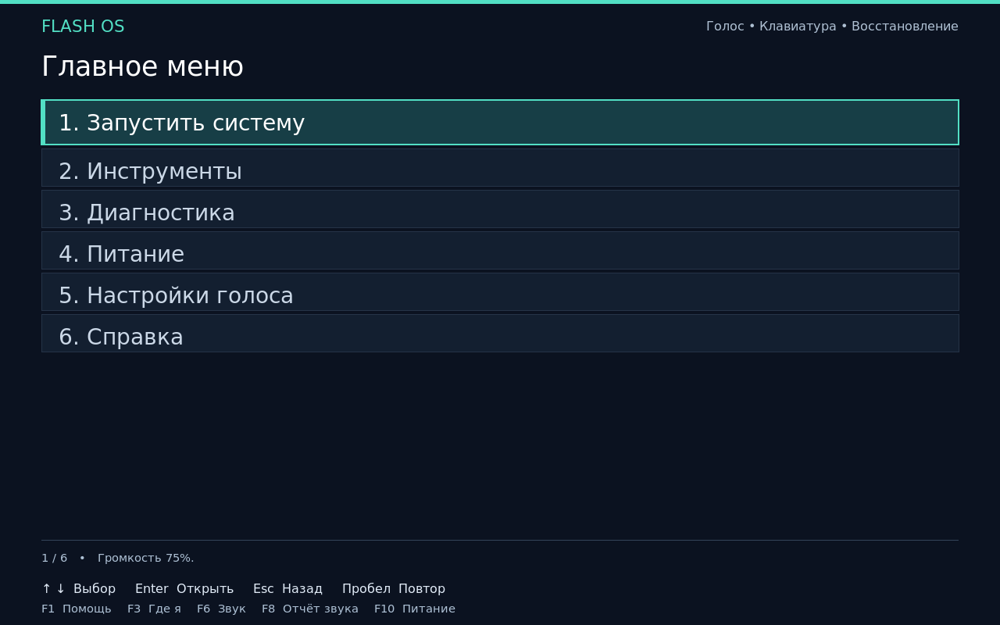
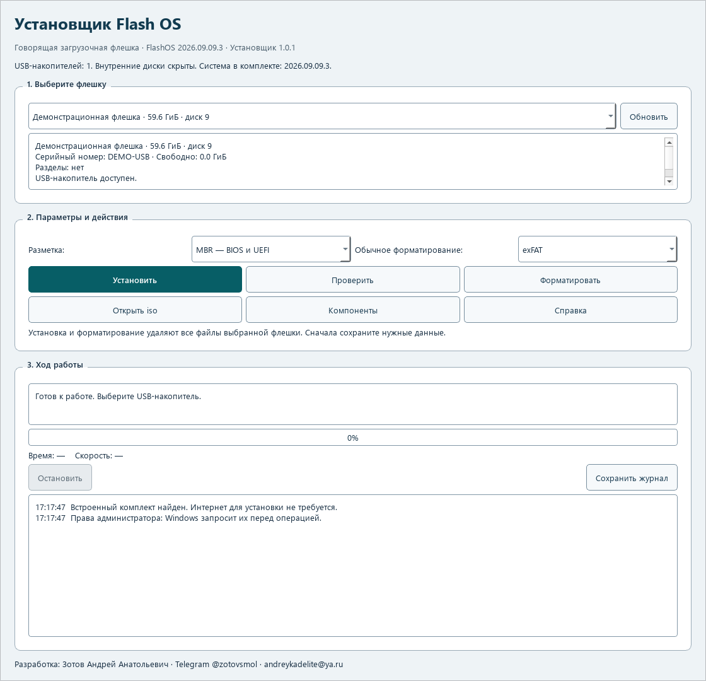

# FlashOS VoiceBoot

Русский · [English](README.en.md)

FlashOS — загрузочная система с озвучкой меню. Она помогает незрячему пользователю запустить установщик ОС с флешки, проверить компьютер и восстановить данные с помощью клавиатуры. Флешку подготавливает отдельный установщик для Windows.

Чтобы добавить систему, скопируйте её файл `.iso` в папку `iso` на флешке. Распаковывать образ не нужно. FlashOS перечитывает папку при загрузке и по F5, озвучивает список и запускает выбранный образ через Ventoy.

**[Скачать установщик EXE](https://github.com/andreykadelite/flashos-voiceboot/releases/latest/download/FlashOS-Setup.exe)** · [Все файлы релиза](https://github.com/andreykadelite/flashos-voiceboot/releases/latest) · [Инструкция](docs/ru/guide.md) · [Что нового](docs/ru/release-2026.10.22.md)

Текущий выпуск: FlashOS **2026.10.22.2**, установщик **1.0.10**.

В «Инструментах» доступен [терминал с озвучкой команд и вывода](docs/ru/guide.md#терминал-с-озвучкой). Это полноценный Bash с историей, автодополнением и обычными клавишами программ. Можно читать экран и отдельные строки, переключать чтение ввода и авточтение, останавливать речь. Терминал работает в графическом режиме с правами root в системной среде; подготовка магазина и интернет не нужны.

Магазин восстанавливает прерванные операции, проверяет файлы зависимостей и свободное место перед распаковкой, обновляет зависимости из выбранных источников. Поиск доступен по названиям и полным описаниям пакетов. Диагностика различает недоступный журнал и отсутствие ошибок, учитывает ошибки служб и недостоверные показания датчиков. При проверке SHA256 используется запись для выбранного ISO.

Настройки Ethernet и Wi-Fi включают DHCP/статику IPv4 и IPv6, DNS, маршруты и прокси, сохранённые профили с привязкой к ПК и адаптеру, зашифрованные пароли с общим паролем и подтверждение подключения с откатом. При ошибке соединения магазин предлагает сетевые инструменты и явный повтор загрузки. [Настройки сети и ограничения](docs/ru/guide.md#проводная-сеть-wi-fi-и-сохранённые-профили).

Поиск Wi-Fi повторяет обнаружение адаптера, при необходимости загружает пропущенный драйвер и сохраняет сведения о подключении. Неудачное быстрое подключение возвращает прежнюю сеть. В системе сохранены прежние исправления просмотра больших папок, предпросмотра текста, передачи выбора ISO и работы установщика с GPT.

«Приложения» открывает магазин и установленные программы. Для загрузки пакетов нужен интернет; программы и настройки сохраняются на флешке. Внешние окна озвучивает Orca через AT-SPI, если приложение поддерживает доступность. По умолчанию Orca следует речи FlashOS: Елена RHVoice, ещё четыре голоса RHVoice и резервный eSpeak NG. В «Утилитах» можно выбрать отдельный голос Orca и настроить речь, размер текста, контрастность, анимацию и указатель. Ctrl+Alt+Escape закрывает внешнюю сессию и возвращает в FlashOS. [Как пользоваться магазином](docs/ru/guide.md#приложения-и-магазин-debian) · [Настройки приложений и Orca](docs/ru/guide.md#утилиты-и-настройки-приложений).

## Подготовка флешки

Установщик работает в Windows 10 1809+ и Windows 11 x64. Это один EXE со встроенной системой, загрузчиками, драйверами и голосами. Python, Qt и интернет на целевом ПК не нужны. Образы Windows и Linux добавьте сами после установки FlashOS.

Меню FlashOS и установщика сейчас русскоязычное. Документация есть на русском и английском; английский интерфейс в этот выпуск не входит.

Снимки экрана: меню, терминал и установщик

## Начало работы

1. Скачайте `FlashOS-Setup.exe` из [последнего релиза](https://github.com/andreykadelite/flashos-voiceboot/releases/latest).
2. Подключите флешку от 4 ГБ. Для установочных образов лучше взять 16 ГБ или больше. Сохраните её прежние файлы на другом носителе.
3. Запустите EXE и подтвердите запрос прав администратора Windows до открытия меню. Выберите флешку по модели, размеру и серийному номеру, затем нажмите «Установить».
4. Сверьте выбранное устройство и подтвердите действие. **Установка удалит все разделы и файлы на этой флешке.** Дождитесь окончания записи и проверки.
5. Скопируйте свои ISO в папку `iso` на разделе **FLASHOS**. Подпапки разрешены.
6. Подключите наушники или колонки, загрузите ПК с USB и дождитесь приветствия. Откройте «Запустить систему», выберите образ стрелками и нажмите Enter.

Для передачи выбора Ventoy компьютер перезапускается. В BIOS может понадобиться снова выбрать USB. Озвучка выбранного установщика зависит от его собственных средств доступности.

## Что умеет FlashOS

Главное меню: «Запустить систему», «Инструменты», «Диагностика», «Приложения», «Утилиты», «Питание», «Настройки голоса», «Справка». При навигации читается выбранный пункт. Пробел повторяет его, F3 сообщает раздел и положение. F7 останавливает текущую речь FlashOS. Длинные вводные реплики также пропускаются Enter или пробелом; это не подтверждает действие в следующем меню. Запуск ISO и приложений не ждёт окончания произнесения названия.

- Сведения о процессоре, модулях памяти, дисках, разделах, графике, сети и подключённых драйверах.
- Подробные SMART/NVMe-отчёты, поддерживаемые диском самотесты и проверка чтения.
- Проверки доступной RAM через memtester, процессора, файловых систем, сети, датчиков, звука и клавиатуры.
- Образы разделов Partclone с проверкой и восстановлением; копирование диска в файл через ddrescue; поиск файлов PhotoRec и поддерживаемые исправления файловых систем.
- Просмотр и копирование файлов, подключение Wi-Fi, сохранение отчётов.
- Терминал Bash с озвучкой команд, вывода и строк экрана, историей и автодополнением.
- Пять голосов RHVoice, запасной eSpeak NG, выбор звукового выхода и сохранение настроек голоса.

В [инструкции](docs/ru/guide.md) описаны ограничения проверок и операции, которые меняют данные. Наличие утилиты в комплекте не означает, что все её режимы доступны через голосовое меню.

## Совместимость

FlashOS рассчитана на x86-64 с BIOS или 64-битным UEFI. Установщик принимает USB-носители с логическим сектором 512 байт. ARM, Apple Silicon и 32-битный UEFI этой сборкой не поддерживаются.

**Для первого запуска с Secure Boot может понадобиться регистрация ключа Ventoy. Этот экран прошивки не озвучивается FlashOS.** Некоторые компьютеры запрещают сторонние сертификаты или внешнюю загрузку. Самостоятельный первый запуск на любом ПК не гарантируется.

В комплекте много драйверов и прошивок Linux, но работа зависит от оборудования. F6 переключает звуковой выход. Проверка памяти охватывает доступную RAM, а не всю установленную память. Озвучка FlashOS не переносится в сторонние установщики ОС.

EXE пока без подписи издателя. Скачивайте его со страницы проекта.

## Документация и исходники

- [Работа с FlashOS](docs/ru/guide.md) · [Установщик Windows](docs/ru/installer.md)
- [Сборка обеих частей](docs/ru/build.md) · [Устройство проекта](docs/ru/architecture.md)
- [Решение проблем](docs/ru/troubleshooting.md)
- [Компоненты и версии](docs/ru/components.md) · [Лицензии и архивы исходников](THIRD-PARTY.md)
- [Участие в разработке](CONTRIBUTING.md) · [Изменения](CHANGELOG.md)

В `src/` находится говорящая система, в `installer/` — приложение Qt и модуль записи Windows, в `boot/` — загрузочные конфигурации. В `build/`, `tools/` и `tests/` находятся сценарии сборки и проверки. Большие системные файлы и EXE хранятся в релизах и не увеличивают историю Git.

## Автор и лицензия

Разработка: **Зотов Андрей Анатольевич**.

Пишите об ошибках, предлагайте полезные инструменты и улучшения доступности: [GitHub Issues](https://github.com/andreykadelite/flashos-voiceboot/issues), [Telegram @zotovsmol](https://t.me/zotovsmol), [andreykadelite@ya.ru](mailto:andreykadelite@ya.ru). Перед публикацией отчёта удалите личные пути и идентификаторы устройств.

Собственный код и документация проекта распространяются по [MIT](LICENSE). В изменённых версиях сохраняйте уведомление об авторстве и лицензию. У сторонних компонентов свои условия. **Юрий RHVoice имеет ограничение некоммерческого использования и запрет распространения изменённых моделей.** Перед распространением всего комплекта прочитайте [NOTICE](NOTICE.md) и [THIRD-PARTY](THIRD-PARTY.md).
