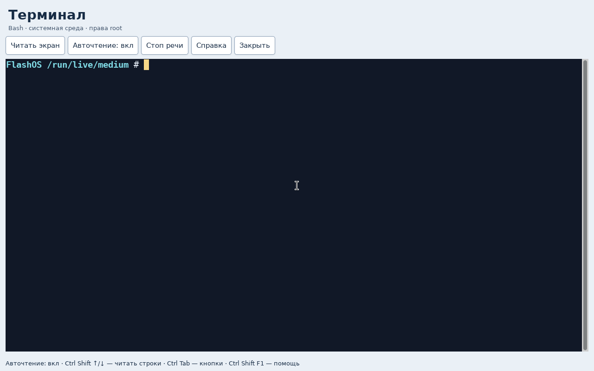

# FlashOS 2026.10.22.2 and installer 1.0.10

[Русский](../ru/release-2026.10.22.md) · [Home](../../README.en.md)

This release adds a standalone terminal with spoken commands and output,
and improves the application store, diagnostics and installer error handling.
The application interface and spoken help remain in Russian.

**[Download FlashOS-Setup.exe](https://github.com/andreykadelite/flashos-voiceboot/releases/latest/download/FlashOS-Setup.exe)** · [All release files](https://github.com/andreykadelite/flashos-voiceboot/releases/latest)

## Spoken terminal

Open **Инструменты → Терминал с озвучкой команд и вывода** (Tools → Terminal
with spoken commands and output). It is a full Bash session in the live system,
with command history, completion, interactive programs and the usual Ctrl+C,
Ctrl+D and Tab. It needs neither internet nor an initialized store.

The terminal reads submitted commands and new output. You can also read the
screen, cursor line and output history, pause automatic reading, stop speech,
select an audio output and resize the font. Toolbar controls support keyboard
navigation and announce their focus.

Hidden program input is not read. Command history stays in session memory.
Multiline paste and closing a running session require confirmation; closing
also stops programs started in the session.

Key shortcuts:

- Ctrl+Shift+A toggles automatic output reading.
- Ctrl+Shift+Space stops speech.
- Ctrl+Shift+R reads the screen; Ctrl+Shift+L reads the cursor line.
- Ctrl+Shift+Up/Down reviews output history lines.
- Ctrl+Tab moves to the toolbar; Escape returns input to the terminal.
- Ctrl+Shift+F1 opens help; Ctrl+Shift+Q requests session closure.

The terminal runs as root in the FlashOS system environment. Store applications
continue to use a separate unprivileged user and environment. See the
[guide](guide.md#spoken-system-terminal) for all controls and input-reading settings.

## Application store

Package description search is faster. Interrupted-operation recovery,
free-space calculation and dependency updates have been improved. Dependencies
installed from Backports retain that origin. A service failure is no longer
reported as a successful operation.

The store still offers Debian 13 and Backports packages, persistent applications
and settings on the USB drive, and Orca speech for supported windows. It shows
the plan and dependencies before changing packages. [Using the store](guide.md#applications-and-debian-store).

## Diagnostics and installer

Incomplete sensor readings and unavailable logs are identified explicitly.
SHA256 manifests select the entry for the chosen ISO, including manifests
containing several files.

The Windows installer improves cancellation before USB writes and failure
reporting. Earlier fixes for large folders, text previews, ISO selection and
partition handling remain included.

## Installation and release files

For normal installation, download only `FlashOS-Setup.exe`. It contains FlashOS,
bootloaders, drivers and voices. The destination PC needs no Python, Qt setup or
internet connection to prepare the USB drive. Add your installation ISOs to the
`iso` folder afterwards.

**Installation deletes every partition and file on the selected USB drive.**
Before reinstalling, copy ISOs, documents, settings and the application store's
`store.ext4` file to another device. [Installation steps](installer.md).

- `FlashOS-Setup.exe`: ready-to-use Windows x64 installer.
- `FlashOS-2026.10.22.2-system.7z`: prepared system tree for building the EXE.
  It is not an ISO or an image for Rufus or dd.
- `FlashOS-2026.10.22.2-source.zip`: project sources and documentation.
- The other five `sources.zip` archives provide third-party sources. Dates in
  their names identify the original source sets; these components remain part
  of this release. [Licenses and source archives](../../THIRD-PARTY.md).

## Compatibility

The installer targets Windows 10 1809+ and Windows 11 x64. FlashOS boots on
x86-64 PCs with BIOS or 64-bit UEFI. First use with Secure Boot may require
Ventoy key enrollment on a firmware screen without FlashOS speech. The EXE
is currently unsigned. Speech inside a third-party OS installer depends on
that installer's own accessibility features.
