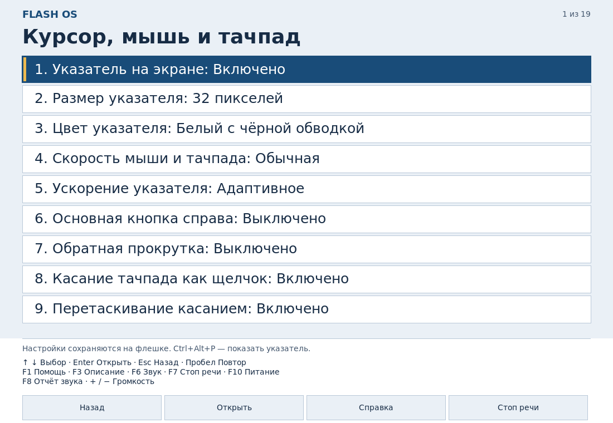
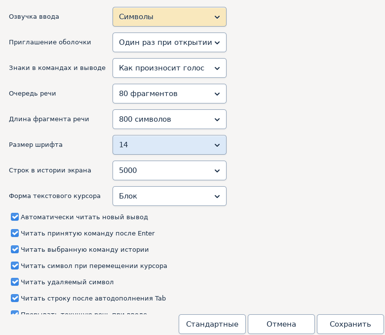

# Как пользоваться FlashOS

[English](../en/guide.md) · [Главная](../../README.md)

FlashOS загружается с флешки, читает меню вслух и помогает запустить установщик ОС или проверить компьютер. Инструкция описывает FlashOS 2026.10.27.1 и установщик 1.0.11. Изменения перечислены в [описании выпуска](release-2026.10.27.md). Для подготовки флешки в Windows используйте [установщик](installer.md).

## Образы и первый запуск

Скопируйте файлы `.iso` на раздел FLASHOS в папку `iso`. Подпапки разрешены, распаковка не нужна. Давайте образам понятные имена: например, `Windows-11-Russian.iso` или `Debian-amd64.iso`. Название и сведения из образа помогают понять, что выбрано.

Подключите наушники или колонки и выберите USB в меню загрузки компьютера. Клавиша вызова этого меню зависит от прошивки. До запуска FlashOS меню компьютера и экран регистрации ключа Secure Boot не озвучиваются.

Дождитесь приветствия. Откройте «Запустить систему», выберите образ стрелками и нажмите Enter. Запуск не ждёт окончания произнесения названия ISO. Компьютер перезагрузится, после чего Ventoy запустит выбранный ISO. Это обычный порядок запуска образа из FlashOS. На компьютере с BIOS иногда нужно ещё раз выбрать USB в меню загрузки. При следующем старте с флешки снова откроется голосовое меню.

Папка `iso` проверяется при каждой загрузке. Удалённый образ исчезнет, добавленный появится. F5 обновляет список без перезапуска. Проверка образа определяет его загрузочную структуру, но не гарантирует работу каждого стороннего установщика. После передачи управления озвучка зависит от самого установщика.

## Клавиши

| Клавиша | Действие |
| --- | --- |
| Вверх / вниз | Выбрать предыдущий / следующий пункт |
| Enter | Открыть пункт или запустить выбранное действие |
| Escape | Назад; во время задания запросить остановку |
| Home / End | Начало / конец списка |
| Page Up / Page Down | Перейти на десять строк |
| Пробел | Повторить пункт или состояние задания |
| F1 | Справка текущего экрана |
| F3 | Раздел, положение и подробности выбора |
| F5 | Заново прочитать папку ISO |
| F6 | Следующий звуковой выход |
| F7 | Остановить текущую речь FlashOS |
| F8 | Сохранить диагностику звука |
| + / − | Громкость |
| F10 | Питание; сначала остановка активного задания |

На ноутбуке может понадобиться Fn. В поле ввода Enter принимает текст, Escape отменяет, Backspace удаляет символ. Пароли не произносятся. Отчёты читаются построчно; длинная строка озвучивается полностью.

Графическое и резервное текстовое меню используют одинаковые клавиши и озвучку. В графическом режиме мышь необязательна. При выборе произносится только пункт; название раздела можно узнать по F3.

Длинную вводную реплику, например предупреждение о доступности магазина или описание настроек, можно остановить F7, Enter или пробелом. Нажатие Enter или пробела во время такой реплики пропускает только речь: пункт следующего меню не запускается и подтверждение не принимается. Для выбора нажмите нужную клавишу после появления меню. F7 не отменяет уже начатое задание; для остановки задания используйте Escape и дождитесь безопасного завершения.

## Приложения и магазин Debian

В главном меню откройте «Приложения» → «Магазин приложений Debian». При первом использовании создайте хранилище, обычно 2 ГиБ. Это файл `flashos/applications/store.ext4` на основном разделе FLASHOS; место выделяется полностью, поэтому кроме файлов системы и ISO нужен запас для приложений. Существующие файлы флешки сохраняются.

Стрелки влево/вправо и Tab выбирают вкладки «Доступные», «Установленные», «Обновления». Вверх/вниз выбирают строку, Enter открывает действие, Escape возвращает назад. F2 ищет по названию и описанию, F4 выбирает источник, F5 обновляет каталог через интернет, F3 читает подробности. Каталог содержит пакеты Debian, включая библиотеки без отдельного запускаемого окна.

Источники — официальные Debian 13, security, updates и Backports с разделами Main, Contrib, Non-free и Firmware. Подписи обязательны, Backports выбираются явно. Перед установкой, обновлением или удалением прочитайте полный план: версии, зависимости, объём загрузки и требуемое место. Подтверждение применяется ко всему плану; при удалении проверьте также зависимые приложения. После записи проверяется состояние пакетов. Escape ждёт безопасного завершения изменения.

Если Debian недоступен из-за ошибки соединения, магазин предлагает «Перейти в Инструменты и подключиться к сети». Выберите временное подключение Wi-Fi, проводную сеть по DHCP или сохранённый профиль; при необходимости проверьте DNS и интернет. Escape возвращает к предложению магазина, где можно повторить загрузку или вернуться без неё. Вкладка, поиск и источник сохраняются. Подключение также доступно отдельной строкой магазина. Наличие сетевого адреса само по себе не подтверждает доступ к Debian. Временный пароль Wi-Fi действует до перезагрузки; для сохранения создайте профиль сети.

Без интернета можно читать ранее загруженный каталог и запускать установленные приложения. После ошибки загрузки пакетов повтор установки заново проверяет план и требует подтверждения. Если запись пакетов уже началась, автоматический повтор недоступен: подключитесь к сети и откройте проверку прерванной установки в «Хранилище и свободное место». Ошибки подписи, свободного места и источников показываются отдельно от ошибок соединения.

В «Установленных приложениях» доступны запуск и удаление. Запуск приложения не ждёт окончания голосового объявления. Графические приложения работают от отдельного пользователя с Orca; часть программ не поддерживает скринридер или требует своих настроек. Control прерывает текущую речь Orca. Ctrl+Alt+Escape закрывает внешнюю сессию и возвращает в FlashOS, Alt+F4 обычно закрывает активное окно. Перед закрытием сохраните документы.

«Хранилище и свободное место» показывает место внутри образа и на флешке, предлагает увеличение до 3/4/8/16 ГиБ и проверку прерванной установки. FAT32 допускает файл хранилища до 3 ГиБ, exFAT — большие размеры. Программы и настройки переносятся на другой компьютер x86-64 вместе с флешкой. Перед переустановкой сохраните `store.ext4` на другом носителе. Извлекайте флешку после обычного выключения через FlashOS.

## Проводная сеть, Wi-Fi и сохранённые профили

Эти настройки входят в FlashOS 2026.10.13.2. Результаты и границы проверки сборки указаны в [отчёте о проверках](testing.md).

Откройте «Инструменты» → «Подключение к сети и проверка интернета» → «Настройки IP, DNS, прокси и сохранённые профили». Быстрые пункты Wi-Fi и DHCP создают подключение на текущий сеанс. Для повторного использования выберите создание проводного профиля или профиля Wi-Fi, затем нужный адаптер. Можно найти Wi-Fi сканированием или ввести SSID вручную, в том числе для скрытой сети. Редактор поддерживает открытые сети, WPA2 Personal и WPA3 Personal; корпоративный вход 802.1X/EAP и WEP в нём не настраиваются.

IPv4 и IPv6 настраиваются отдельно. Для IPv4 доступны DHCP, статический адрес и отключение. Для IPv6 — автоматический SLAAC/DHCPv6, только DHCPv6, статика и отключение. Статический адрес вводится с префиксом: например, `192.168.1.20/24`; несколько адресов разделяются пробелами. Шлюз можно оставить пустым для локальной сети. DNS можно указать вручную, получить автоматически при DHCP/SLAAC или отключить для выбранной версии IP; доступны домены поиска. Для статической версии IP укажите DNS вручную или используйте DNS другой версии IP, полученный автоматически: выбор автоматического DNS сам по себе не запускает DHCP для статического адреса. Метрика задаёт приоритет маршрутов: меньшее число предпочтительнее. Пункт «Только локальная сеть» запрещает этому соединению маршрут по умолчанию. Дополнительные маршруты вводятся как `сеть/префикс шлюз метрика`, несколько — через точку с запятой; для прямого маршрута вместо шлюза укажите `-`. Используйте адреса и DNS своей сети, примеры не являются готовой конфигурацией.

Редактор изменяет черновик. «Сохранить профиль на флешку» сохраняет параметры после подтверждения; Escape отменяет несохранённое редактирование. Для применения откройте сохранённый профиль и выберите «Подключить и проверить». Новое соединение проверяется, затем FlashOS даёт до 60 секунд на подтверждение. По умолчанию выбран отказ; Escape, истечение срока или ошибка возвращают предыдущее соединение. Таймер отката поддерживает NetworkManager. Подтверждение не заменяет проверку доступности нужных ресурсов: адрес может быть получен и без интернета.

Каждый профиль привязан к компьютеру и постоянному MAC-адресу адаптера. Переименование интерфейса не переносит его на другой адаптер. Автоподключение изначально выключено; при включении для одного адаптера прежний автоматический профиль этого компьютера выключается. При возвращении на тот же ПК с тем же адаптером разрешённый профиль применяется снова. Если этот ПК подключили к другой кабельной сети, прежняя статика может быть неподходящей: оставьте её ручной или используйте отдельный профиль. Профиль другого ПК автоматически не применяется; можно создать его отдельную копию для текущего компьютера и адаптера. Прежний профиль сохраняется, у копии автоподключение выключено. Если постоянные идентификаторы недоступны, используйте временное подключение.

При загрузке FlashOS автоматически устанавливает не более одного сохранённого соединения и прекращает попытки после первого успешного подключения. Остальные профили, в том числе для второго адаптера, можно подключить вручную.

Для Wi-Fi с автоматическим IP можно разрешить ручное использование на другом ПК. Переносимый профиль не допускает статические адреса, шлюзы и дополнительные маршруты. На незнакомом ПК он подключается только по вашему выбору; автоматическое подключение остаётся привязанным к исходному ПК и адаптеру. Для новой статики создайте отдельный профиль или копию с новой привязкой.

Параметры находятся в `flashos/network/profiles.json` на служебном разделе FLASHBOOT. IP, SSID, имя пользователя прокси и прочие параметры не зашифрованы; пароли Wi-Fi и прокси хранятся отдельно в `flashos/network/secrets.bin`, защищённом AES-256-GCM и общим паролем хранилища. При первом сохранении пароля FlashOS просит создать и повторить общий пароль длиной не менее восьми символов. Он не произносится и не сохраняется на флешке. При загрузке на известном ПК разблокируйте хранилище для подключения защищённой сети; Escape позволяет продолжить без сохранённых паролей. В меню хранилища доступны блокировка и смена общего пароля. Блокировка не разрывает уже установленное соединение. Забытый пароль не позволяет прочитать сохранённые секреты; сохраните пароль и резервную копию всего каталога `flashos/network`.

Прокси задаётся для профиля отдельно для HTTP и HTTPS, например `http://proxy.example:3128`. Имя пользователя вводится отдельным полем, пароль — защищённым вводом; не добавляйте их в URL. Можно указать адреса и домены исключений. Прокси применяется к магазину APT и новым приложениям, которые учитывают переменные `http_proxy`, `https_proxy` и `no_proxy`; уже открытые приложения нужно перезапустить. Программы с собственными настройками прокси настраиваются отдельно. Редактор не поддерживает PAC/WPAD. Диагностика сети проверяет прямой доступ, поэтому её результат может отличаться от доступа магазина через прокси.

## Курсор, мышь и тачпад

Откройте «Утилиты → Доступность — курсор, мышь и тачпад». Подготовка магазина не требуется. Каждый пункт озвучивается и доступен с клавиатуры. Значения сохраняются автоматически в разделе `pointer` файла `flashos/settings.json` на FLASHBOOT и применяются при старте графического меню и после подключения устройства.

| Настройка | Варианты |
| --- | --- |
| Указатель | Показать или скрыть; размер 24, 32, 48, 64 пикселя |
| Цвет | Белый, чёрный или жёлтый с контрастной обводкой |
| Скорость | Пять ступеней от медленной до очень быстрой |
| Ускорение | Адаптивное или постоянная скорость |
| Основная кнопка | Слева или справа |
| Прокрутка | Обычная или обратная; шаг колеса в меню 1, 3, 5 пунктов |
| Тачпад | Касание как щелчок, перетаскивание касанием, защита при печати |
| Способ прокрутки тачпада | Автоматический, двумя пальцами, вдоль края |
| Кнопки тачпада | Автоматический выбор, области нажатия, число пальцев |
| Средняя кнопка | Эмуляция одновременным нажатием двух кнопок |
| Открытие пункта | Двойной щелчок или один щелчок |

По умолчанию один щелчок основной кнопкой выбирает и читает строку, двойной открывает её. Колесо или прокрутка тачпада перемещает выбор без перехода с конца списка в начало. Дополнительная кнопка возвращает назад; при основной кнопке справа дополнительной становится левая. Нижние кнопки «Назад», «Открыть», «Справка», «Стоп речи» доступны мышью. В режиме одного щелчка пункт открывается сразу: подтверждения опасных действий сохраняются.

Скрытие курсора не отключает мышь и тачпад. В меню FlashOS Ctrl+Alt+P показывает курсор и сохраняет это значение; клавиатура остаётся доступной. Внешнее приложение сначала закройте или вернитесь в FlashOS его обычным сочетанием. Размер и цвет собственного курсора применяются в меню, дочерним приложениям передаётся размер Xcursor; отдельные программы рисуют свои указатели.

«Прочитать все настройки» повторяет значения, «Устройства и применение» показывает обнаруженные указатели и ошибки применения. Параметры XInput применяются только при наличии соответствующего свойства и возможности устройства. Сохранённое пожелание не доказывает поддержку функции конкретным тачпадом. В текстовом режиме параметры можно сохранить для следующего графического запуска. Сенсорные экраны и многооконные жесты тремя пальцами этим разделом не настраиваются. Беспроводные мыши с USB-приёмником используют поддержку USB HID; сопряжение Bluetooth этим разделом не настраивается.

## Утилиты и настройки приложений

После «Приложений» в главном меню находится «Утилиты». Откройте «Настройки доступности приложений Debian — GSettings». Все пункты и значения озвучиваются: стрелки выбирают, Enter открывает, Escape возвращает назад. Сначала сохраните документы и закройте внешние приложения. Если хранилище ещё не создано, FlashOS предложит его подготовить.

Доступны размер текста 100/125/150/200 процентов, высокая контрастность, включение или отключение анимации и размер указателя 24/32/48 пикселей. Отдельный пункт проверяет доступность для экранного диктора и позволяет восстановить её включённое состояние. «Прочитать все настройки» сообщает сохранённые значения. Настройки внешнего вида не отключают диктор и не меняют голос FlashOS или профиль Orca.

Изменения подтверждаются и сохраняются в пользовательском профиле внутри `store.ext4` на флешке; они применяются при следующем запуске приложения и переносятся с флешкой на другой ПК. «Сбросить параметры этой утилиты» требует подтверждения и восстанавливает только размер текста, контрастность, анимацию и указатель, сохраняя документы, прочие ключи и файлы профиля Orca. Доступность для диктора остаётся включённой.

Настройки рассчитаны на поддерживающие их приложения GTK. Другие программы могут использовать собственный масштаб, тему и средства доступности; озвучка Orca требует поддержки AT-SPI. Ctrl+Alt+Escape закрывает внешнюю сессию и возвращает в FlashOS; обычное закрытие окна — Alt+F4.

### Голос и речь экранного диктора Orca

В «Утилитах» откройте «Настройки экранного диктора Orca — голос и речь». Сначала сохраните документы и закройте внешнее приложение. По умолчанию выбран режим «Как в FlashOS»: при каждом запуске приложения Orca получает текущий голос и параметры речи FlashOS. Стандартный голос — Елена RHVoice. В обоих средах доступны те же Елена, Ирина, Анна, Александр и Юрий RHVoice, а также русский eSpeak NG.

Для отдельной речи выберите голос и синтезатор, скорость, высоту или громкость и подтвердите указанные значения. Orca перейдёт на собственные настройки, которые не меняют речь меню FlashOS. Шкалы Orca идут от 0 до 100; скорость и высота 50 — середина шкалы. Это другие шкалы, чем в настройках FlashOS. «Вернуть речь как в FlashOS» восстанавливает следование текущим параметрам меню после подтверждения.

«Прослушать пример выбранным голосом Orca» использует настоящий синтезатор приложения. Escape останавливает пример и возвращает в настройки; F7 останавливает встроенную речь FlashOS. В запущенном приложении текущую речь Orca прерывает Control, а Caps Lock плюс пробел открывает собственное окно настройки Orca.

Настройки записываются в штатный файл Orca `/home/flashos-app/.local/share/orca/user-settings.conf` внутри `store.ext4`, сохраняются на флешке и применяются при следующем запуске приложения на любом ПК. Сброс речи сохраняет прочие профили, произношения, брайлевские параметры и горячие клавиши. Уже изменённая пользователем речь Orca не заменяется автоматически: такой профиль использует отдельные настройки. Из прежнего образа автоматически обновляется только точный стандартный профиль, созданный FlashOS. Если в режиме следования изменить речь через собственное окно Orca, эти изменения сохраняются и дальнейшее автоматическое следование прекращается.

При использовании прежнего `store.ext4` общие голоса берутся из текущей системы. Повторно создавать хранилище, переустанавливать приложения или заменять пользовательские библиотеки для этого не требуется. Утилита изменения речи поддерживает включённый экранный диктор.

## Инструменты и диагностика

«Инструменты» открывает сведения о ПК, операции с файлами, сетью, отчётами и резервными копиями. «Диагностика» содержит проверки памяти, процессора, дисков, файловых систем, сети, датчиков, звука и клавиатуры.

Сведения о ПК собираются из доступных интерфейсов Linux и прошивки: процессор, модули RAM, устройства PCI/USB, накопители, разделы и драйверы. Виртуальная машина, USB-переходник или прошивка могут скрыть часть полей. Отсутствующее значение не означает неисправность.

SMART и NVMe показывают подробный отчёт и поддерживаемые самим диском тесты. Некоторые USB-корпуса не передают команды SMART. Статус «пройдено» не исключает потерю данных и не заменяет резервную копию.

Проверка RAM использует memtester и озвучивает ход и результат. Она проверяет выделенную доступную память. Области, занятые ядром и самой FlashOS, остаются вне теста. Если закрепить память через mlock не удалось, результат не считается достоверным. Проверка CPU создаёт нагрузку; её можно остановить Escape.

Проверки файловых систем работают без исправления. Ремонт находится в отдельном разделе и требует подтверждения. Проверка чтения не доказывает исправность записи. Результаты сохраняются в отчёты; перед публикацией уберите из них личные пути, сетевые адреса и серийные номера.

## Резервные копии и ремонт

Откройте «Инструменты» → «Резервные копии, восстановление и ремонт».

«Создать образ раздела» использует Partclone для ext2/3/4, FAT, exFAT, NTFS, XFS и Btrfs, если раздел можно корректно прочитать. Он должен быть размонтирован. Копия сохраняется в новую папку `backups` на FLASHOS. Храните всю папку: `partition.pcl`, `blocks.map` и `flashos-backup.json`. После записи проверяются образ и занятые блоки источника. Незавершённая копия без паспорта не предлагается для восстановления.

«Проверить резервный образ» перечитывает файл, проверяет SHA256 и контрольные суммы Partclone. «Восстановить раздел из образа» **заменяет содержимое целевого раздела**. Его размер должен быть не меньше исходного. Сверьте устройство по F3 и подтвердите выбор. Образ проверяется до записи, занятые блоки восстановленного раздела — после неё.

Это копия одного раздела, а не всей загрузочной структуры диска. После восстановления UUID файловой системы совпадает с исходным; не подключайте обе копии к установленной системе одновременно. Если запись прервана, не загружайте частично восстановленный раздел — повторите восстановление из проверенной копии.

Для диска с ошибками чтения есть копирование в файл через ddrescue с картой прохода. Его IMG/MAP не являются образом Partclone; автоматического восстановления таких файлов из этого меню нет.

PhotoRec ищет файлы по содержимому и сохраняет найденное в `recovery` на флешке. Исходный раздел не изменяется. Имена и папки обычно теряются; встречаются дубликаты и неполные файлы. Шифрование без ключа, перезапись и TRIM могут сделать восстановление невозможным. Нужен запас свободного места.

«Исправить файловую систему» меняет выбранный раздел. Поддерживается автоматический ремонт ext2/3/4, FAT и exFAT с повторной проверкой. Сначала сохраните образ или важные данные. Наличие в системе других утилит не означает, что все их режимы ремонта выведены в доступное меню.

## Голос, питание и сохранение

В «Настройках голоса» доступны Елена, Ирина, Анна, Александр и Юрий RHVoice, резервный eSpeak NG, скорость, высота, громкость, сигналы и период сообщений. По умолчанию выбрана Елена RHVoice. Настройки автоматически сохраняются в `flashos/settings.json` на FLASHBOOT. Ошибка сохранения озвучивается. Звуковой выход по F6 выбирается на текущий сеанс: на другом ПК карты определяются заново. [Лицензии голосов](../../THIRD-PARTY.md).

«Питание» позволяет выключить ПК, перезапустить его, перейти в основную систему, выбрать установленную систему или запросить вход в UEFI. Выбор установленной ОС использует подходящие записи UEFI и BootNext, не меняя постоянный порядок загрузки. Это не полный поиск всех ОС. В BIOS, при отсутствующей записи UEFI или недоступном EFI-разделе выбирайте диск средствами прошивки.

FLASHOS — основной exFAT-раздел с ISO и системой; VTOYEFI — служебный раздел Ventoy на 32 МиБ; FLASHBOOT — FAT32 около 512 МиБ с ядром, initrd, загрузочными файлами и настройками. Не удаляйте служебные файлы и не обновляйте Ventoy штатной кнопкой Update: она может заменить конфигурацию FlashOS.

Для переустановки сначала скопируйте ISO, `backups`, `recovery`, отчёты, `flashos/settings.json`, `flashos/terminal.json`, весь каталог `flashos/network` и `flashos/applications/store.ext4` с соответствующих разделов на другой носитель. Установка через EXE удаляет их. Извлекайте флешку после штатного выключения.

### Если подготовка хранилища не завершилась

Подготовка 2, 4 или 8 ГиБ включает выделение места, создание ext4, распаковку,
проверку файлов и сохранение данных. На медленной флешке это может занять
несколько минут. Не отключайте её во время работы; следите за текущим этапом.
Отчёт об ошибке сохраняется на FLASHBOOT в `flashos/reports`.

После прерывания магазин предлагает проверить подготовку или сохранить
незавершённый образ в архив. Проверка завершает только полностью записанную
среду. Если файл неполон или не содержит ext4, выберите «Сохранить незавершённый
образ в архив и создать новый», подтвердите сохранение и снова выберите размер.
Старый файл останется в `flashos/applications/incomplete` и продолжит занимать
место. Готовое хранилище с установленными приложениями автоматически не заменяется.

### Управление окнами приложений

Alt+Tab переключает окна вперёд, Alt+Shift+Tab — назад. Alt+F10 разворачивает
окно и возвращает прежний размер. Alt+F7 включает перемещение стрелками,
Alt+F8 — изменение размера; Enter подтверждает, Escape отменяет изменение.
Alt+F4 закрывает активное окно. Если открыт несохранённый документ, сначала
ответьте на запрос приложения. Ctrl+Alt+Escape завершает внешнюю сессию и
возвращает в меню FlashOS. Эти сочетания также перечислены в говорящей справке.

## Терминал с озвучкой

Откройте «Инструменты → Терминал с озвучкой команд и вывода». Это полноценный Bash live-системы с правами root, историей, автодополнением и диагностическими утилитами. Подготовка магазина и интернет не нужны. Требуется графический режим; резервное текстовое меню сохраняет прежние говорящие инструменты.

По умолчанию при наборе произносятся символы. Приглашение оболочки — текст перед командой — читается один раз при открытии окна. Затем автоматически читается новый вывод, а принятая команда произносится отдельно после Enter, если это включено. Эхо символов, чтение принятой команды и авточтение вывода настраиваются независимо. Редактирование команды не должно повторно озвучивать всё приглашение.

`pwd` показывает текущую папку, а `cd` без параметров возвращает в домашний каталог. При запуске из системной службы отсутствующий HOME восстанавливается по учётной записи. Знак `~` в приглашении обозначает только этот домашний каталог; в штатном окружении `/run` отображается как `/run`.

Tab дополняет имена; стрелки вверх/вниз выбирают историю. Ctrl+C прерывает программу, Ctrl+D передаёт конец ввода. Клавиши запущенных программ сохраняют обычное назначение.

| Сочетание | Действие |
| --- | --- |
| Ctrl+Shift+P | Настройки терминала |
| Ctrl+Shift+E | Переключить эхо: символы, слова, оба режима, выключено |
| Ctrl+Shift+A | Включить или выключить авточтение нового вывода |
| Ctrl+Shift+Пробел или Ctrl+Shift+F7 | Остановить речь и очередь |
| Ctrl+Shift+R / Ctrl+Shift+L | Прочитать видимый экран / строку у курсора |
| Ctrl+Shift+↑/↓ | Предыдущая / следующая строка снимка истории вывода |
| Ctrl+Shift+Home / Ctrl+Shift+End | Первая строка снимка / обновить снимок и прочитать последнюю |
| Shift+PageUp / Shift+PageDown | Прокрутить терминал |
| Ctrl+Tab, затем Tab | Перейти к кнопкам и выбрать кнопку |
| Escape | Вернуть фокус в терминал или отменить диалог |
| Ctrl+Shift+C / Ctrl+Shift+V | Копировать / вставить |
| Shift+Insert | Вставить выделение |
| Ctrl+плюс / Ctrl+минус | Изменить размер шрифта |
| Ctrl+Shift+F6 | Следующий звуковой выход |
| Ctrl+Shift+F1 | Справка |
| Ctrl+Shift+Q | Закрыть с подтверждением |

После «Стоп речи» автоматический вывод остаётся остановленным. Эхо букв продолжает работать, но сам набор не снимает остановку. Принятая команда после Enter, явное чтение или возобновление снова разрешают вывод, если авточтение включено. Приостановленное авточтение не воспроизводит накопившийся старый вывод после включения. Снимок истории для ручного чтения не перемещает курсор Bash.

### Настройки терминала

Нажмите «Настройки терминала» или Ctrl+Shift+P. Tab и Shift+Tab переходят между озвучиваемыми полями; стрелки меняют выбор, пробел переключает флажок. «Сохранить» применяет значения и записывает их на флешку; «Отмена» сохраняет прежние параметры. «Стандартные» подставляет исходные значения в диалог: их ещё нужно сохранить.

| Параметры | Варианты |
| --- | --- |
| Эхо ввода | Символы, слова, символы и слова, выключено |
| Приглашение оболочки | Один раз при открытии, после каждой команды, не читать |
| Знаки в командах и выводе | Как произносит голос, основные, все |
| Чтение при редактировании | Отдельно история команд, символ у курсора, удаление, строка после Tab |
| Речь при вводе | Прерывать текущую реплику; объявлять заглавные буквы |
| Авточтение и команда | Отдельно новый вывод и принятая команда после Enter |
| Очередь речи | 20, 80 или 200 фрагментов; длина 200, 800 или 1600 символов |
| Текст | Шрифт от 9 до 28; история 1000, 5000 или 20000 строк |
| Текстовый курсор | Блок, вертикальная черта, подчёркивание; мигание |
| Дополнительно | Прокрутка при выводе, звуковой сигнал, вставка средней кнопкой, вводная подсказка, сообщение о завершении оболочки |

Параметры терминала хранятся в `flashos/terminal.json` на служебном разделе FLASHBOOT, отдельно от `flashos/settings.json`. Создавать хранилище приложений не нужно. Голос, скорость и громкость берутся из общих настроек речи FlashOS при открытии окна. Переключение эха, авточтения и быстрый размер шрифта также сохраняются. Ошибка записи озвучивается; не отключайте флешку до штатного выключения.

Прямое эхо клавиш действует при редактировании команды Bash. Ввод внешних программ не перехватывается; их текст доступен через вывод и чтение экрана. Скрытый ввод программ не озвучивается. Команда, в которую секрет введён обычным видимым текстом, остаётся видимой: перед таким вводом отключите эхо, чтение принятой команды и авточтение. История Bash и служебные данные сессии находятся в RAM и не входят в файл настроек; программы могут сохранять собственные файлы. При переполнении ограниченной очереди звучит уведомление; полный доступный текст остаётся на экране. Для больших журналов используйте `less` или перенаправление в выбранный файл.

Многострочная вставка и закрытие работающей сессии требуют подтверждения. Закрытие production-сессии завершает её дочерние процессы. Внешние приложения магазина по-прежнему работают от отдельного пользователя; параметры Orca настраиваются в «Утилитах».
